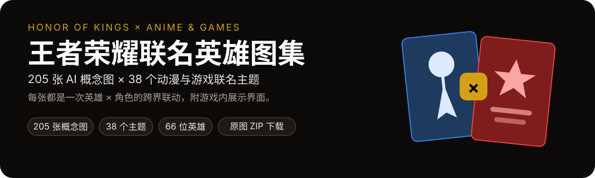
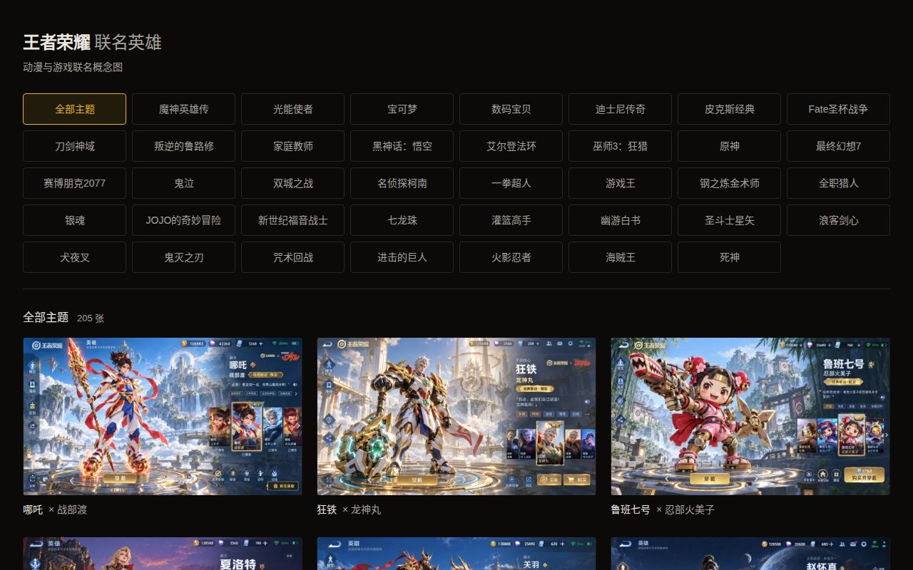
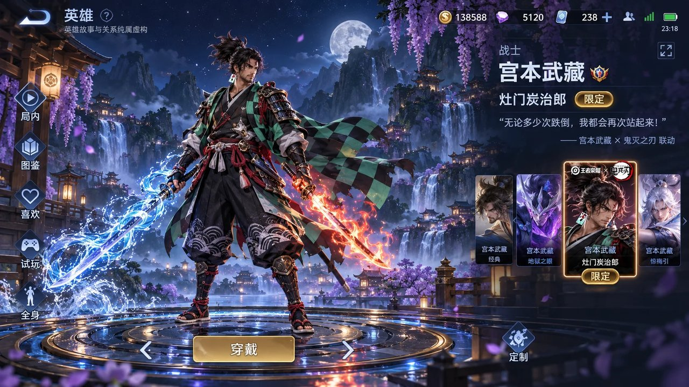

<p align="right"><a href="README.md">中文</a></p>

<p align="center">
  
</p>

<p align="center">
  <a href="https://crossover-folk-gallery.xiaosang.cc/">▶ View Online</a>
  ·
  <a href="https://github.com/holynova/crossover-folk-gallery">GitHub Repository</a>
</p>

A gallery of 205 AI-generated Honor of Kings crossover concepts across 38 anime and game themes — Damo × Goku, Miyamoto Musashi × Tanjiro Kamado, Xiang Yu × Vegeta — each rendered as an in-game hero showcase screen. Filter by theme, open any image fullscreen, navigate with arrow keys, close with Esc.

AI-generated fan concepts, not official skins. Characters and trademarks belong to their respective owners.

## Screenshots

<p align="center">
  
</p>

<p align="center">
  
</p>

## Contents

- **205 artworks, 38 themes**: 5 per theme, except 鬼灭之刃 Demon Slayer with 20; 66 Honor of Kings heroes in total.
- **Themes include**: 七龙珠 Dragon Ball, 灌篮高手 Slam Dunk, 鬼灭之刃 Demon Slayer, 咒术回战 Jujutsu Kaisen, 进击的巨人 Attack on Titan, 火影忍者 Naruto, 海贼王 One Piece, 死神 Bleach, JOJO 的奇妙冒险 JoJo's Bizarre Adventure, 新世纪福音战士 Neon Genesis Evangelion, 名侦探柯南 Detective Conan, 原神 Genshin Impact, 黑神话：悟空 Black Myth: Wukong, 艾尔登法环 Elden Ring, 赛博朋克 2077 Cyberpunk 2077, 双城之战 Arcane, 宝可梦 Pokémon, 迪士尼传奇 Disney Legends.
- **Every artwork's structure**: hero × crossover character, presented as an in-game showcase screen (hero name, skin name, limited-edition badge, voice line, equip button).
- **Original packs**: `downloads/` holds 19 themed ZIP packs (grouped by theme) for downloading the original PNGs in bulk.

## Features

- **Theme filters**: equal-width theme tags, one click to filter.
- **Fullscreen viewer**: click for the high-resolution image, arrow keys to navigate, Esc to close.
- **Infinite scroll**: 12 artworks per batch, loading automatically on scroll (or tap 「加载更多图片」 ("Load more") where auto-loading isn't supported).
- **Performance**: 480/960px responsive WebP thumbnails, high-res images load only on click; fast paging cancels stale requests, at most 3 decoded large images are kept and released on close. Measured results in [PERFORMANCE.md](./PERFORMANCE.md) (mobile LCP 5.04s → 2.27s, first high-res image 14.48s → 1.39s).

## Run Locally

Plain HTML, CSS and JavaScript, no framework dependencies:

```bash
python3 -m http.server 8080
# Open http://localhost:8080/
```

Regenerate derivatives and site data (needs `cwebp`):

```bash
node scripts/optimize-gallery.mjs
node scripts/build-site.mjs
```

## Tech

- Zero-framework static site: data is `assets/js/data.js` (205 entries, with three-tier image paths and original PNG paths).
- Images in three tiers: 480/960px WebP thumbnails + full-size high-res WebP (`media/gallery/`, 615 in total) + original PNGs (`images/`, 268, including folk and test material).
- Fingerprinted image paths for long-term caching; source changes generate new paths.

```
index.html              Entry: 38 theme tags (hardcoded) + gallery container
assets/js/data.js       205 artwork entries: theme, hero, character, three-tier image paths
assets/js/app.js        Gallery logic: filtering, infinite scroll, fullscreen viewer
assets/js/downloads.js  Themed ZIP downloads
media/gallery/          615 WebP images: small / large / detail per artwork
images/                 268 original PNGs (including folk, fusion and test material)
downloads/              19 themed ZIP packs
```
