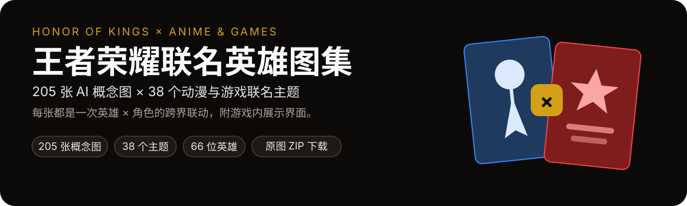
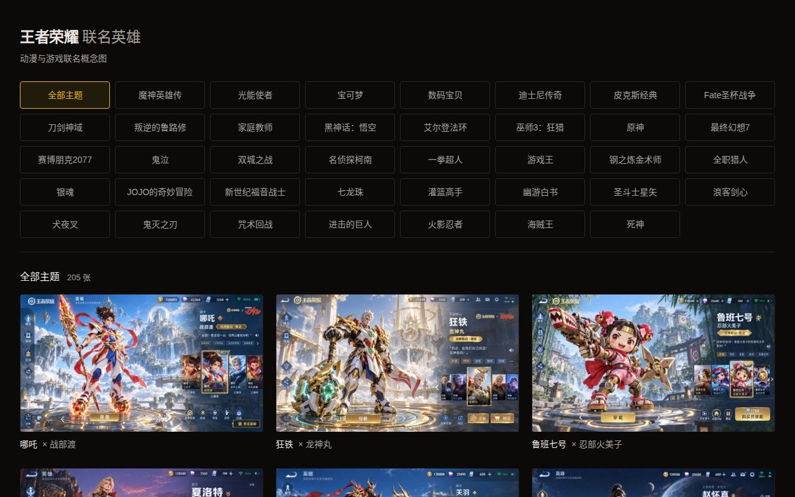
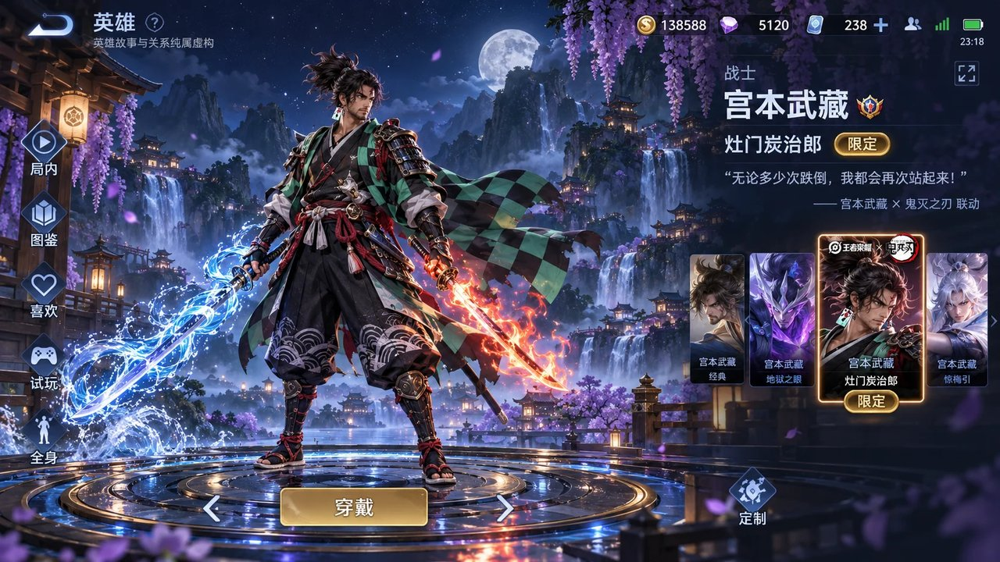

<p align="center">
  
</p>

<p align="center">
  <a href="https://crossover-folk-gallery.xiaosang.cc/">▶ 在线浏览 View Online</a>
  ·
  <a href="https://github.com/holynova/crossover-folk-gallery">GitHub 仓库</a>
</p>

205 张王者荣耀联名英雄 AI 概念图，按 38 个动漫与游戏主题分类：达摩 × 孙悟空、宫本武藏 × 灶门炭治郎、项羽 × 贝吉塔……每张都画成游戏内英雄展示界面的样子。点击主题标签筛选，点击图片看大图，支持方向键切换与 Esc 关闭。

A gallery of 205 AI-generated Honor of Kings crossover concepts across 38 anime and game themes — Damo × Goku, Miyamoto Musashi × Tanjiro Kamado, Xiang Yu × Vegeta — each rendered as an in-game hero showcase screen. Filter by theme, open any image fullscreen, navigate with arrow keys, close with Esc.

AI 创作，非官方联名概念，不代表真实上线的皮肤。角色与商标归各自权利人。

## 截图 / Screenshots

<p align="center">
  
</p>

<p align="center">
  
</p>

## 内容 / Contents

- **205 张，38 个主题**：37 个主题各 5 张，鬼灭之刃 20 张；覆盖 66 位王者英雄。
- **主题举例**：七龙珠、灌篮高手、鬼灭之刃、咒术回战、进击的巨人、火影忍者、海贼王、死神、JOJO 的奇妙冒险、新世纪福音战士、名侦探柯南、原神、黑神话：悟空、艾尔登法环、赛博朋克 2077、双城之战、宝可梦、迪士尼传奇。
- **每张的结构**：英雄 × 联名角色，配游戏内展示界面（英雄名、皮肤名、限定标记、台词、穿戴按钮）。
- **原图打包**：`downloads/` 有 19 个主题 ZIP 包（按主题分组），可整包下载原始 PNG。

## 功能 / Features

- **主题筛选**：等宽主题标签，一键过滤。
- **全屏查看器**：点击看高清大图，方向键切换，Esc 关闭。
- **滚动追加**：列表每批 12 张，滚动自动加载（不支持时可点「加载更多图片」）。
- **性能**：480/960px WebP 响应式缩略图，高清图点击后才加载；快速翻页取消旧请求，最多保留 3 张已解码大图，关闭后释放。实测对比见 [PERFORMANCE.md](./PERFORMANCE.md)（手机 LCP 5.04s → 2.27s，首次高清图 14.48s → 1.39s）。

## 本地运行 / Run Locally

纯 HTML、CSS 和 JavaScript，无框架依赖：

```bash
python3 -m http.server 8080
# 打开 http://localhost:8080/
```

重新生成衍生图与站点数据（需要 `cwebp`）：

```bash
node scripts/optimize-gallery.mjs
node scripts/build-site.mjs
```

## 技术 / Tech

- 零框架静态站：数据是 `assets/js/data.js`（205 条，含三级图片路径与原始 PNG 路径）。
- 图片三级：480/960px WebP 缩略图 + 原尺寸高清 WebP（`media/gallery/`，共 615 张）+ 原始 PNG（`images/`，268 张，含民俗与测试素材）。
- 带指纹的图片路径长期缓存，源码变更生成新路径。

```
index.html              入口：38 个主题标签（硬编码）+ 画廊容器
assets/js/data.js       205 条作品数据：主题、英雄、角色、三级图片路径
assets/js/app.js        画廊逻辑：筛选、滚动追加、全屏查看器
assets/js/downloads.js  主题 ZIP 下载
media/gallery/          615 张 WebP：每张作品 small / large / detail 三级
images/                 268 张原始 PNG（含民俗、融合与测试素材）
downloads/              19 个主题 ZIP 包
```

## English

**Honor of Kings Crossover Gallery** — 205 AI-generated crossover concepts across 38 anime and game themes, each rendered as an in-game hero showcase screen.

- **205 artworks, 38 themes**: 5 per theme, except Demon Slayer with 20; 66 Honor of Kings heroes in total.
- **Themes include**: Dragon Ball, Slam Dunk, Demon Slayer, Jujutsu Kaisen, Attack on Titan, Naruto, One Piece, Bleach, JoJo's Bizarre Adventure, Evangelion, Detective Conan, Genshin Impact, Black Myth: Wukong, Elden Ring, Cyberpunk 2077, Arcane, Pokémon, Disney.
- **Browse**: filter by theme tag, open fullscreen, arrow keys to navigate, Esc to close. Batches of 12 load on scroll.
- **Downloads**: 19 themed ZIP packs of original PNGs in `downloads/`.
- **Run it**: `python3 -m http.server 8080` — plain HTML/CSS/JS, no framework. Regenerate derivatives with `node scripts/optimize-gallery.mjs && node scripts/build-site.mjs` (needs `cwebp`).
- **Tech**: 615 WebP derivatives in `media/gallery/` (small/large/detail per artwork), fingerprinted paths for long-term caching. Performance notes in `PERFORMANCE.md`.

AI-generated fan concepts, not official skins. Characters and trademarks belong to their respective owners.
